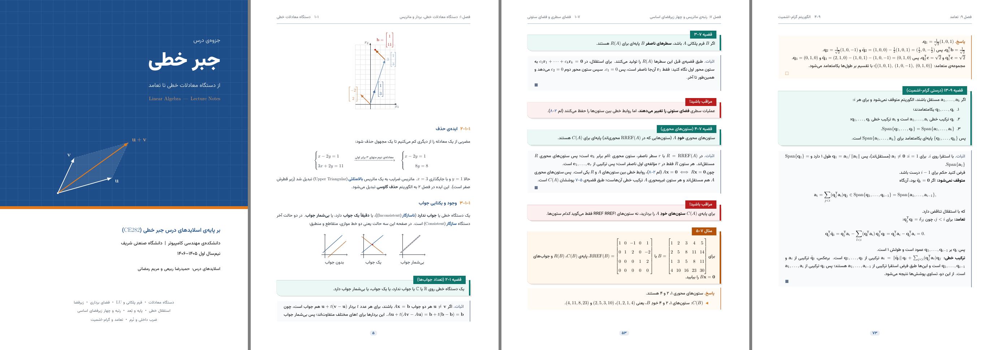

<div dir="rtl">

# جزوه‌ی جبر خطی

جزوه‌ی کامل و فارسیِ درس **جبر خطی (CE282)** دانشکده‌ی مهندسی کامپیوتر دانشگاه صنعتی شریف، بر پایه‌ی اسلایدهای درس (حمیدرضا ربیعی و مریم رمضانی). مطالب اسلایدها به شکل یک متن پیوسته، کوتاه و کتاب‌گونه نوشته شده و با زبان ساده توضیح داده شده تا برای خواندنش پیش‌نیاز خاصی لازم نباشد.



## خواندن آنلاین و دانلود

- **نسخه‌ی وب (روی موبایل هم راحت خوانده می‌شود):** https://radanmohseni86-ctrl.github.io/Linear-algebra/
- **[دانلود فایل PDF جزوه (jozve.pdf)](jozve.pdf)** — حدود ۸۵ صفحه.

## چه چیزی در این جزوه هست؟

- **اثبات قضیه‌های اسلایدها:** هر جا در اسلایدها جای اثبات خالی مانده بود، اثباتی کوتاه و روشن نوشته شده است.
- **حل مثال‌ها:** مثال‌های بی‌پاسخ اسلایدها حل شده‌اند.
- **جعبه‌های رنگی مثل کتاب‌های درسی:** تعریف، قضیه، لم، اثبات، مثال، پاسخ، نکته، «مراقب باشید!»، شهود و جمع‌بندی هر کدام جعبه‌ی جدا دارند.
- **شکل‌های هندسی:** تصویر سطری و ستونی دستگاه‌ها، پوشش خطی، چهار زیرفضای اساسی، دایره‌ی واحد نُرم‌ها و … .
- **فصل پیش‌درآمد** برای مرور مجموعه، سیگما، اعداد مختلط و میدان.
- **تمرین با پاسخ کوتاه** در پایان هر فصل و **واژه‌نامه‌ی انگلیسی به فارسی** در پیوست.
- **اصلاح چند خطای اسلایدها** (همراه با پانویس توضیحی).
- راست‌چین بودن متن فارسی و چپ‌چین بودن فرمول‌ها و اصطلاحات انگلیسی با دقت تنظیم شده است.

## فهرست فصل‌ها

| فصل | موضوع |
|:---:|:---|
| ۰ | پیش‌درآمد: نمادهای پایه |
| ۱ | دستگاه معادلات خطی، بردار و ماتریس (ضرب داخلی، ضرب ماتریس‌ها، عملیات سطری، ماتریس‌های مقدماتی) |
| ۲ | فرم‌های پلکانی و حل دستگاه‌ها (RREF، وجود و یکتایی جواب، دستگاه همگن، تجزیه‌ی LU، تعبیر هندسی) |
| ۳ | فضای برداری |
| ۴ | زیرفضا (اشتراک، اجتماع، پوشش خطی، جمع و جمع مستقیم) |
| ۵ | استقلال خطی (بردارها، توابع و چندجمله‌ای‌ها) |
| ۶ | پایه و بُعد (فرمول بُعد، مختصات) |
| ۷ | رتبه‌ی ماتریس و چهار زیرفضای اساسی (قضیه‌ی رتبه-پوچی، ماتریس وارون‌پذیر) |
| ۸ | فرم‌های خطی، ضرب داخلی و نُرم (فرم دوخطی، کوشی-شوارتز، نُرم و متر) |
| ۹ | تعامد (مجموعه‌های یکامتعامد، مکمل متعامد، الگوریتم گرام-اشمیت) |
| پیوست | واژه‌نامه‌ی انگلیسی به فارسی |

## ساختار مخزن

| مسیر | محتوا |
|:---|:---|
| `jozve.pdf` | خروجی نهایی جزوه |
| `jozve.tex` | فایل اصلی LaTeX |
| `tex/preamble.tex` | تنظیمات ظاهری: فونت‌ها، رنگ‌ها، جعبه‌ها و صفحه‌آرایی |
| `tex/cover.tex` و `tex/preface.tex` | جلد و «درباره‌ی این جزوه» |
| `chapters/` | هر فصل در یک فایل جدا |
| `fonts/` | فونت وزیرمتن (با مجوز SIL OFL) |
| `web/` | ساخت نسخه‌ی وب از روی همین فایل‌های LaTeX (خروجی روی شاخه‌ی `gh-pages` منتشر می‌شود) |

## ساختن PDF از روی سورس

جزوه با **XeLaTeX** و بسته‌ی **XePersian** نوشته شده است. فونت فارسی (وزیرمتن) داخل مخزن است، پس لازم نیست جداگانه نصبش کنید.

روی لینوکس (اوبونتو/دبیان):

</div>

```bash
sudo apt install texlive-xetex texlive-lang-arabic texlive-latex-extra texlive-pictures texlive-science latexmk
make
```

<div dir="rtl">

یا بدون `make`:

</div>

```bash
latexmk -xelatex jozve.tex
```

<div dir="rtl">

روی ویندوز و مک هم با نصب کامل TeX Live یا MiKTeX همین دستور کار می‌کند. در Overleaf کافی است کامپایلر را روی XeLaTeX بگذارید.

برای ساختن نسخه‌ی وب (به Node.js و pandoc هم نیاز است) دستور زیر را بزنید؛ خروجی در پوشه‌ی `site/` ساخته می‌شود:

</div>

```bash
make web
```

<div dir="rtl">

## مشارکت

اگر اشتباهی دیدید یا پیشنهادی دارید، یک Issue باز کنید یا اصلاحیه را به صورت Pull Request بفرستید. هر فصل یک فایل جدا در پوشه‌ی `chapters/` است و جعبه‌ها با محیط‌های ساده‌ای مثل `definition`، `theorem`، `proof`، `example`، `solution`، `note` و `warning` نوشته می‌شوند.

اسلایدهای درس متعلق به مدرسان درس است و این جزوه برای استفاده‌ی آموزشی دانشجویان تهیه شده است.

</div>
